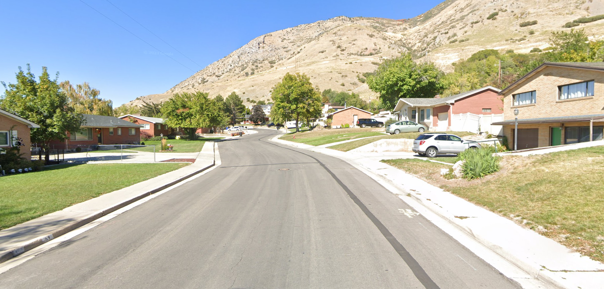
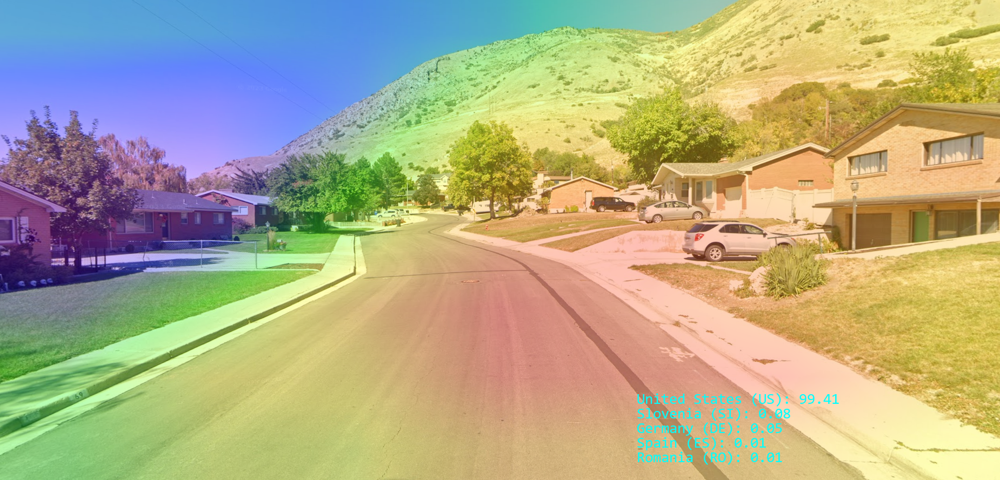
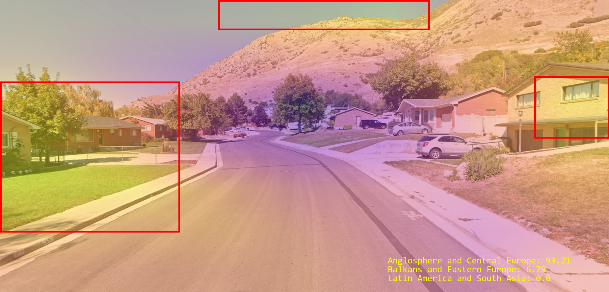

<div align="center">


# Kopernik

<p align="center">
  <a href="https://github.com/FLMxN/kopernik/blob/main/LICENSE"></a>
  
  
  
  <a href="https://github.com/FLMxN/kopernik/stargazers"></a>
</p>

Open-source deep learning research tool for inspecting geographic data based on landscape pictures inside or outside of urbanity via neural networks.

</div>

## Table of contents
- [Architecture](#architecture)
- [Project layout](#project-layout)
- [Installation](#installation)
  - [Requirements](#requirements)
  - [Python dependencies](#python-dependencies)
  - [Model and input setup](#model-and-input-setup)
- [Understanding predictions](#understanding-predictions)
- [Inference](#inference)
  - [CLI](#cli)
  - [GUI](#gui)
  - [Pretty output digest](#pretty-output-digest)
- [License](#license)

## Architecture
Kopernik uses two **ResNet-50** classifiers initialized with **ImageNet-1K** weights:

- The country classifier predicts **56** country labels.
- The regional classifier predicts one of **7** project-defined regions.

The training scripts use different datasets: [torch_trainer.py](backend/torch_trainer.py) loads the [grouped country dataset](https://huggingface.co/datasets/stochastic/random_streetview_images_grouped_v1), while [torch_trainer_reg.py](backend/torch_trainer_reg.py) loads the [panorama dataset](https://huggingface.co/datasets/stochastic/random_streetview_images_pano_v0.0.2).

**Dataset credit:** [stochastic](https://huggingface.co/stochastic) (Winson Truong).

## Project layout
- [backend/](backend): Python inference, training, API, and Streamlit application.
- [desktop/](desktop): Electron launchers for the React and Streamlit apps.
- [src/](src): React/Vite frontend and its assets.
- [pics/](pics): sample and uploaded input images.
- [output/](output): generated Grad-CAM images and checked-in examples.
- Root-level `package.json`, `vite.config.js`, and `index.html`: npm and Vite configuration.

## Installation
### Requirements
| Requirement | Details |
|---|---|
| **Python** | **3.12** or newer |
| **Dependencies** | see below |
| **Node.js** and **npm** | for the Electron desktop app |
| **CUDA**-compatible **NVIDIA** GPU | Recommended for faster inference and training; CPU inference is *also supported*. |

### Python dependencies
Install PyTorch using the command recommended by the [official PyTorch installer](https://pytorch.org/get-started/locally/) for your OS and CUDA setup, then install the remaining packages:
```
python -m pip install scikit-learn datasets numpy opencv-python pillow tqdm python-dotenv streamlit
```

### Model and input setup
1. Download the fine-tuned checkpoint file(s) you want to use from the [Kopernik Hugging Face model repository](https://huggingface.co/flmxn/resnet50-streetview).
2. Copy [.env.example](.env.example) to `.env` and set the paths to your checkpoint(s) and input image:
```
CKPT=path/to/country_checkpoint.pth
CKPT_REG=path/to/regional_checkpoint.pth
INPUT_IMG=pics/us1.png
PRETTY=1
```

`CKPT` and `CKPT_REG` can point to the country and regional checkpoints respectively. The CLI can run either model independently; set `INPUT_IMG` to an image file for CLI inference. `PRETTY=1` enables the summarized output. Use `PRETTY=0` for diagnostic output. The `.env.example` file also lists `COUNTRY_IMG` and `REGION_IMG`, which are updated when visualizations are generated.

To train models instead, edit the settings in [torch_trainer.py](backend/torch_trainer.py) (country) or [torch_trainer_reg.py](backend/torch_trainer_reg.py) (regional) and run the corresponding script as a module from the repository root:
```
python -m backend.torch_trainer
python -m backend.torch_trainer_reg
```
Training downloads its dataset from Hugging Face and requires the training dependencies above, including PyTorch and torchvision.

## Understanding predictions

> [!NOTE]
> This section summarizes observed behavior of the current developer checkpoints. Predictions and label tendencies may change with different models or training data.

> [!IMPORTANT]
> It`s a common mistake to take prediction as-is, when working with a mathematical model (such as this one). Interpret labels in the context of the model and its training data; the model may respond to visual similarities rather than country-specific features.

Predictions are estimates from the model, not verified locations. Scores depend on the checkpoint and training data; treat them as relative model outputs, not calibrated measures of geographic certainty. The country model's pretty output groups Argentina, Bhutan, Cambodia, Eswatini, and New Zealand under `UNDEFINED`.

> [!TIP]
> In pretty output, the **5** null point attractor labels are grouped under **UNDEFINED**.

The labels can also act as visual "attractors": a prediction may reflect shared image features rather than the actual country. Based on observed model behavior:

- **Null point attractors:** **New Zealand (NZ)**, **Bhutan (BT)**, **Eswatini (SZ)**, **Cambodia (KH)**, and **Argentina (AR)** often appear for ambiguous images, such as scenes with visual noise or few distinctive details. Treat these predictions as especially unreliable.
- **Common attractors:**
  - **Taiwan (TW)** and **South Korea (KR)** can represent developed, often Asian-looking landscapes, but may also appear for scenes from China, India, Japan, Australia, the USA, Russia, Europe, or the Americas.
  - **Czech Republic (CZ)** can appear for post-Soviet and other Eastern European landscapes, including rural or small urban scenes.
  - **Greece (GR)** can appear for Balkan and Eastern European landscapes, including small urban scenes.
  - **Finland (FI)** can appear for northern European landscapes and, in some cases, large urban scenes in East Asia.
  - **Spain (ES)** can appear for European urban landscapes, including scenes from France, Portugal, and Italy, as well as some American landscapes.
- **Particular attractors:**
  - **Romania (RO)**, **Mexico (MX)**, and **Ukraine (UA)** can appear for broad, nonspecific scenes such as highways.
  - **Japan (JP)** can appear for lush green vegetation.
  - **Botswana (BW)** can appear for landscapes in Japan.
  - **Canada (CA)** can appear for neighborhoods in the USA.
  - **Sweden (SE)** can appear for townhouse settlements in North America or Oceania.
  - **Andorra (AD)** can appear for visually noisy or dense landscapes in Latin America.
  - **Poland (PL)** can appear for southern recreational or resort locations.

Grad-CAM highlights image areas associated with a prediction; it is a qualitative visualization, not proof of the model's reasoning.

## Inference
### CLI
With `.env` configured and at least one checkpoint available, run inference from the repository root:
```
python -m backend.torch_main
```

The script reads `INPUT_IMG`, writes available visualizations to `output/`, and prints predictions. To enable diagnostic output for a single run, pass `verbose`:
> [!TIP]
> Run `python -m backend.torch_main verbose` to enable diagnostic output for a current inference run.

### GUI
To start the Streamlit interface in your browser:
```
python -m streamlit run backend/gui.py
```

To run it in the Electron desktop window, create a project-root `venv`, activate it, and install the Python dependencies from the section above into that environment. Then install the **npm** dependencies; the Electron launcher uses the project `venv` directly:
```
python -m venv venv
# Windows:
venv\Scripts\activate
# macOS/Linux:
source venv/bin/activate
# Install Python packages as described above, then:
npm install
npm run dev:streamlit
```

### Pretty output digest
The images and predictions below are an example for the checked-in sample image; results can vary with the checkpoint.


> 1260 East 50 North, Springville, UT 84663, USA
```
✅ Extracted model_state_dict from checkpoint
✅ Checkpoint loaded successfully (country)
✅ Extracted model_state_dict from checkpoint
✅ Checkpoint loaded successfully (regional)
```
Inference script successfully loaded and initialized both models: country and regional.
```
Particular predictions:
    United States (US): 99.41
    Estonia (EE): 0.25
    Slovenia (SI): 0.08
    Germany (DE): 0.05
    Chile (CL): 0.05
    Spain (ES): 0.01
    Romania (RO): 0.01
```

Country model is confident and determined enough to assume **United States of America** (US) as a top prediction. Visualization implies a definite significance of <ins>**houses** and **trees** in the left of the image</ins>.
```
Regional predictions:
    Anglosphere and Central Europe: 93.21
    Balkans and Eastern Europe: 6.79
    Latin America and South Asia: 0.00
```

Regional model is confident and determined enough to assume **Anglosphere and Central Europe** as a top prediction. Visualization implies a definite significance of <ins>**houses** in the left of the image</ins>, a <ins>**house** in the right of the image</ins> and a <ins>**hill valley** in the top of the image</ins>.

### License
MIT, see [LICENSE](LICENSE)
